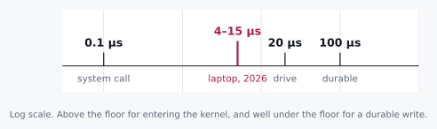

# Success, Too Soon

> Any sufficiently advanced measurement is indistinguishable from a lie.


I want to start with something you can do right now, without leaving
this page. Write four kilobytes to a file. Time the call. See what comes
back.

Here it is in Python, so there is nothing to set up. Paste it into a
file and run it from a directory on your real disk.

```python
import os, statistics, time

block = b"x" * 4096               # four kilobytes
fd = os.open("success.log", os.O_WRONLY | os.O_CREAT | os.O_TRUNC)
times = []

for _ in range(1000):
    start = time.perf_counter()
    os.write(fd, block)
    times.append(time.perf_counter() - start)

os.close(fd)
print(f"median of 1000: {statistics.median(times) * 1e6:.1f} µs")
```

`os.write` is not Python being clever. It is the operating system's own
`write()` call with a thin wrapper around it, no buffer of Python's in
between, which is exactly why I picked it. The loop appends four
kilobytes a thousand times, the way a log grows, and reports the middle
one, so that one slow call cannot fool you.

Write your number down. Then answer one more question before you read
on, and write that down too: **when `write()` said success, were your
four kilobytes on the disk?**

On a laptop in 2026 this printed between 4 and 15 µs, and most of that
spread was the power setting: about 4 plugged in and set for
performance, 10 to 15 in power-saving mode. Yours will be in the same
neighbourhood, a few microseconds or a few tens of them, and nothing
below depends on which.

<p class="quip">"Success" meant the kernel took your letter. Nobody said anything about delivering it.</p>

Now, once you have seen a number like that a few times, it stops
registering. It's small, the write worked, the test passed, and there's a
whole afternoon of other work waiting. I have done exactly this and
thought nothing of it. But that little number is the loudest thing that
will happen to you all week, and this chapter is about learning to
actually hear it.

We are not going to look anything up. By the end you will know exactly
where those four kilobytes are sitting, and we will have gotten there
with a handful of numbers and some long division, which is honestly all
this ever takes.

## 1.1 Two Candidates and a Missing Number

Let's start where everybody starts. Where could the data actually be?

<div class="aside">
Notice that "candidates" came before "answer." We are not trying to be
right yet. We are trying to bound the space cheaply enough that being
wrong costs us nothing.
</div>

Either it's on the disk, or it's still in memory somewhere. That's a
reasonable first cut. And the reflex that follows, the one I have had a
hundred times, is to say *disk is slower than memory* and feel like
some progress has been made.

It hasn't. Not really. That's a **direction**, and a direction cannot
decide anything by itself. Both candidates are still standing, and we
have no idea which way to lean, because we never asked the question
that actually separates them:

**How much slower?**

This is the habit the whole book is built on, so it is worth saying
plainly. When you name two possibilities, name the ratio between them
in the same breath. The ratio is what tells you whether the question
was worth asking at all.

<div class="rule" id="ratio-triage">
<span class="rule-id">Rule 1 · Ratio triage</span>
Sort your next questions by the spread between their possible answers.
A question whose answers differ by 10× splits the world. Ask it now.
A question whose answers differ by less than 2× is a detail, and
asking it early is procrastination wearing a lab coat.
</div>

## 1.2 The Axioms

Here is the part nobody quite says out loud. Some of this we cannot
derive. Not because we aren't clever enough, but because there is
nothing underneath it to derive *from*.

A cache line on an x86 processor is 64 bytes because somebody, once,
in a meeting, chose 64. What a drive charges to answer a request is
whatever physics and market economics happened to settle on between
them. There is no first-principles path to either number. You just
have to know it, the way you know a stop sign is red.

So let's take them as given. There is no shame in being handed a
constant. The only real shame is needing to be handed the conclusion
too.

And here is a confession about where the constants come from. This
book does its arithmetic on a machine that does not exist. It is a
reference machine with round numbers, the way Donald Knuth's books run
on an imaginary computer called MIX, and for the same reason: an
invented machine never goes out of date. Every real one does.

| What it costs | Reference machine |
|---|---|
| a plain function call | 1 ns |
| an empty system call | 0.1 µs |
| memory copy, one core | 10 GB/s |
| a round trip to the drive and back | 20 µs |
| a durable write: the trip, plus the drive's flush | 100 µs |

They are round on purpose, and about the right size for the machines
of the 2020s, because every question in this chapter is about factors
of ten, not about ten percent. Your machine is faster than the
reference machine at some of these and slower at others. The labs
measure exactly how, so wherever one of my numbers appears, you can put
yours in its place and watch whether the conclusion moves.

The last two rows are the ones that matter today, and the difference
between them is worth a sentence. A drive is a small computer of its
own at the far end of a bus. Any request to it, however small, costs a
trip there and back. A request to make data *durable* costs that trip
plus whatever the drive must do to make the data survive a power cut,
which is the slow part.

<p class="quip">A dozen constants is fewer than most people carry for their own family's birthdays, and considerably more useful at two in the morning.</p>

A dozen numbers roughly like these make up most of the toolkit. That's
it. What we do with them is the entire skill.

## 1.3 Doing the Division

Four kilobytes, and three places they could be when `write()` returns.

Before you read on, look again at the answer you wrote down. I mean it.
Not because the arithmetic is hard, but because committing to a value
you might be wrong about is the whole exercise, and reading past this
sentence without doing it is how you get the comfortable feeling of
learning without any of the learning.

Each place has a floor: the least it could possibly cost to get there.

```
durable on the drive   one trip, plus the flush   ≥ 100   µs
anywhere on the drive  one trip there and back    ≥  20   µs
inside the kernel      one system call            ≥   0.1 µs
```

Now put your number next to them.



Look at where it lands. A few microseconds, against a floor of a
hundred for the thing you were probably hoping for. A durable write cannot be
done in less than a hundred microseconds on the reference machine, any
more than
you can post a letter faster than the postman can walk to the box. And
your drive, as chapter 2 will let you measure, is very likely slower
than the reference machine's, which only widens the gap.

So the honest reading of "success" is not "your data is safe." It is
something smaller, and we are about to find out exactly how much
smaller.

<div class="rule" id="floor-test">
<span class="rule-id">Rule 2 · The floor test</span>
When a measurement beats your theoretical floor, the system is not
fast. The work did not happen.
</div>

Let me digress for a paragraph, because this rule has a family
resemblance to a classic benchmark mistake, and once you have seen it
you will see it everywhere.

Somebody optimizes a numerical loop and reports a speedup of four
hundred times. Four hundred! Everyone is delighted. There is a graph.
What actually happened is that the result of the loop is never read, so
the compiler notices and deletes the entire computation, and the
benchmark is faithfully timing an empty program. The number is real.
The measurement is honest. The work simply did not occur. It happened
while this chapter's own lab was being written: one missing line, and
the compiler deleted a memory copy and reported memory moved in no
time at all. The lab now carries a comment about it.

<p class="quip">The graph was beautiful. Somebody had put the four hundred in bold.</p>

That is the same rule as the one in the box, wearing different clothes,
and it is why I trust it more than almost anything else in this book. A
result that is too good does not mean you won. It means you should go
looking for the step that got skipped. Our write skipped durability.
The question now is what it did instead.

## 1.4 Turning It On Our Own Answer

There is an answer almost everybody likes at this point, and I liked it
too. Drives are fast now. Drives have caches of their own. The write
went to the drive's cache, the drive said thank you, and that is why it
was quick.

So let's turn the floor test on it, exactly the way we would turn it on
somebody else's claim.

The drive's cache is *in the drive*. To put anything in it, the request
has to cross the bus, the drive has to take it, and the answer has to
cross back. That is the round trip in the table, 20 µs on the reference
machine, and no amount of cache at the far end makes the trip shorter.
On the reference machine our write costs about half a microsecond, one
system call and a four-kilobyte copy at 10 GB/s, and the trip to the
drive's cache is forty times longer than that.

<div class="aside">
This is the move that separates knowing the vocabulary from being able
to use it. The floor test does not get to sit on a shelf, waiting for
other people's claims. It applies to your own favourite answer, and it
should be aimed there first.
</div>

Now I have to be honest about your machine, because on a real one this
gap is much narrower than forty, and the lab will show you. The lab's
`O_DIRECT` row skips the kernel's memory and sends the four kilobytes
across the bus to the drive's cache, for real. On that 2026 laptop the
trip took 15 to 35 µs, and a plain `write()` took 4 to 13 µs. Three or
four times apart, in every power setting I tried.

And notice what the power setting did. It moved every one of those
numbers by two or three times, all in the same direction, and it barely
moved the ratio between them. Hold on to that, because the whole book
leans on it: your machine's numbers are yours, and its ratios belong to
the world.

Three or four times apart is not a gap you settle with one run of a
stopwatch, though, and the next section is about exactly that.

What survives is the kernel. Its floor is one system call, 0.1 µs, and
our write lands comfortably above it. The rest of the cost is not
mysterious either: a copy of four kilobytes, plus the filesystem keeping
its books on a file that just grew. On Linux you can watch the books go
away by pointing the snippet at a file in `/dev/shm`, which is memory
pretending to be a disk. The number drops by several times, and nothing
else changed.

So the data is in the kernel's memory: the **page cache**. `write()`
copied your four kilobytes into it and returned. Nothing has asked the
drive for anything yet.

## 1.5 Resisting `strace`

Here is where most of us reach for a tool. I want you to resist for one
more second, and ask what the tool would actually buy.

We asked two questions, and they have very different ratios. The first
was *durable or not*, and its candidates sit ten to a hundred times
apart. A stopwatch settled that one the moment the snippet printed. No
scheduler jitter or thermal drift closes a factor of ten.

The second was *the page cache or the drive's cache*, and on a real
machine those sit only a few times apart. That needs care: the median of
many runs, the lab's `O_DIRECT` row next to your `write()` row, the
power setting held still while you compare them. Or a different kind
of instrument altogether, one that does not measure time at all: the
manual page, which simply tells you, and which we will read in a
moment.

<div class="rule" id="instrument-precision">
<span class="rule-id">Rule 3 · Match the instrument to the ratio</span>
1000× apart, use a wall clock. 20× apart, use a wall clock carefully.
1.5× apart, now you need counters and statistics. Reaching for a
profiler on a 1000× gap isn't rigor. It's procrastination that
produces artifacts.
</div>

<p class="quip">Nobody has ever been criticized in a review for adding more instrumentation, which is most of what is wrong with reviews.</p>

For the day you genuinely need them: `strace -c` counts syscalls,
`perf trace` times them. They are excellent tools and you should need
them far less often than you think.

## 1.6 So Where Is It

Four layers, in the order a write passes through them, top to bottom.
Each bar is how long one write of four kilobytes took to reach that
layer on the same 2026 laptop, set for performance. The left-hand
labels say who owns each layer, and the right-hand column says what
takes it away from you, which is the same thing: a layer is lost when
its owner dies.


At a few microseconds, you are at level two. Not three. Not four.

Level one is worth a word, because `os.write` skipped it on purpose.
Most file APIs do not: `fwrite` in C, `BufWriter` in Rust, `open` in
Python all keep small writes in your own process and make the system
call later, when there is enough to be worth the trip. Their default
buffers are small, 8 KiB in Rust[^rust] and typically 128 KB in
Python,[^python] but four kilobytes fits in either, and a write that
fits never even reaches the kernel.

Now, the names in that diagram are worth complaining about for a
moment. `write()` is the syscall that *leaves* userspace, which the
name rather undersells. Your data lands in page cache, and the manual
page is blunt about what that buys you: "A successful return from
write() does not make any guarantee that data has been committed to
disk."[^write] That is the instrument from the last section, and it
answers the second question outright. And `fsync()` is not "send it to
the kernel," because it is already there. `fsync` is what pushes it
*out* of the kernel, toward the media, and its manual page promises the
part `write()` would not: the data "can be retrieved even if the system
crashes or is rebooted."[^fsync]

<p class="quip"><code>write()</code> does not write and <code>fsync()</code> does not send. Both names are older than I am and neither is going to be fixed now.</p>

Most people know about `fsync`. What catches people off guard is
subtler, and it is the thing I would tattoo on a wall if I could: the
default path in nearly every file API stops short of durable, and you
have to opt into that last step on purpose. Closing a file flushes
userspace into the kernel. It does not sync. The manual page for
`close()` says so in as many words: "A successful close does not
guarantee that the data has been successfully saved to disk."[^close]

Which sets up everything in Part II. That last arrow turns out to be
expensive enough that entire database architectures exist for no reason
other than to avoid taking it more often than they must.

<div class="aside">
<strong>Run it.</strong> <code>experiments/01_write_latency.c</code> writes
four kilobytes four ways, into your process, into the kernel, to the
drive's cache with <code>O_DIRECT</code>, and durably with
<code>fsync</code>, and prints each one against the floors above.
<code>experiments/01_constants.c</code> measures the function call, the
system call and the copy on your machine. Commit to your numbers before
you run either. See <a href="./experiments.md">Experiments</a>.
</div>

<div class="challenges">

## Challenges

No answers here, on purpose. Re-deriving is the point. If you wanted to
re-read, you would have the chat log.

1. Replace `os.write` with Python's own `open()` and `f.write()`, and
   predict the median before you run it. Then explain why a stopwatch
   cannot tell you whether that call reached the kernel, and name an
   instrument that can.

2. Your service acks a client immediately after `write()` returns.
   Name the exact failure that loses acknowledged data, and the one
   that doesn't.

3. Some server drives carry capacitors that let them finish writing
   their cache after the power goes, so they can answer a durable write
   in tens of microseconds. Redo this chapter's division for such a
   drive. Which of the two questions can a stopwatch still settle, and
   what does "durable" now mean at level three?

4. A durable write costs ~100 µs on the reference machine. A small
   `write()` costs a few microseconds. Derive the maximum sustainable
   rate for a system that makes every request durable on its own, and
   explain why real databases beat that number anyway.

</div>

<div class="challenges" id="design-note">

## Design Note: Procrastinating With Rigor

There is a specific failure mode that looks exactly like diligence, and
I have fallen into it more than once.

You have a question. Instead of estimating an answer, you instrument.
Flame graphs. Tracing. A benchmark harness. An argument with a
colleague about statistical significance. Three days later you have
beautiful data about something a single division would have settled in
ten seconds, and the worst part is that everyone involved feels good
about it, because it looked like the careful thing to do.

The tell is that you never wrote down what you *expected*.

Instrumentation without a prediction has no failure condition. Every
result looks interesting. Nothing is surprising. And you learn
remarkably little, because nothing you believed was ever put at risk.
That is the whole trick of it: the process feels rigorous precisely
because it cannot fail.

The discipline is cheap and it stings a little. Before you measure,
commit to a number. Not "faster." Not "I expect an improvement." A
number, with units, that you would be a little embarrassed to be wrong
about by 10×.

Being wrong that way is what makes a lesson stick. I know which of my
numbers were wrong by 10× and I do not remember a single one I got
right.

</div>

[^python]: Python documentation, built-in function `open()`, parameter
    `buffering`: "Binary files are buffered in fixed-size chunks ... On
    most systems, the buffer will typically be 128 kilobytes long."
    <https://docs.python.org/3/library/functions.html#open>. The same
    text is in `help(open)` in your own interpreter.

[^rust]: Rust standard library, `std::io::BufWriter::new`: "Creates a
    new BufWriter<W> with a default buffer capacity. The default is
    currently 8 KiB, but may change in the future."
    <https://doc.rust-lang.org/std/io/struct.BufWriter.html>

[^write]: Linux manual page `write(2)`, NOTES.
    <https://man7.org/linux/man-pages/man2/write.2.html>. Also `man 2 write`.

[^fsync]: Linux manual page `fsync(2)`, DESCRIPTION: "fsync() transfers
    ("flushes") all modified in-core data of ... the file ... to the disk
    device (or other permanent storage device) so that all changed
    information can be retrieved even if the system crashes or is
    rebooted. This includes writing through or flushing a disk cache if
    present." <https://man7.org/linux/man-pages/man2/fsync.2.html>. Also
    `man 2 fsync`.

[^close]: Linux manual page `close(2)`, CAVEATS.
    <https://man7.org/linux/man-pages/man2/close.2.html>. Also `man 2 close`.
