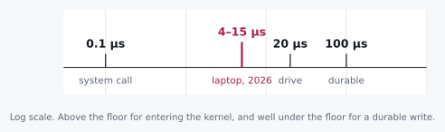

# Twenty-Five Microseconds

> Any sufficiently advanced measurement is indistinguishable from a lie.


I want to start with something you can do right now, without leaving
this page. Write a megabyte to a file. Time the call. See what comes
back.

Here it is in Python, so there is nothing to set up. Paste it into a
file and run it.

```python
import statistics, time

data = b"x" * 1_000_000          # one megabyte
times = []

for _ in range(100):
    with open("megabyte.bin", "wb", buffering=2_000_000) as f:
        start = time.perf_counter()
        f.write(data)
        times.append(time.perf_counter() - start)

print(f"median of 100: {statistics.median(times) * 1e6:.0f} µs")
```

It writes the same megabyte a hundred times and reports the middle one.
That is not fussiness. Run it once, by itself, and the first write is
slow for a reason that has nothing to do with this chapter: the program
is still asking the kernel for the memory its buffer will live in. Keep
an eye on that `buffering=2_000_000`, too. It is going to matter.

On an ordinary machine, on an ordinary day, it comes back in a few tens
of microseconds. On the laptop I am writing this on, it said 35. The C
version of the same experiment, which has no interpreter in the way,
says about twenty-five.[^laptop] That is the number this chapter is
named after.

<p class="quip">Twenty-five microseconds is about how long it takes light to run seven and a half kilometres. Your megabyte did not go anywhere near that far.</p>

Now, once you have seen a number like that a few times, it stops
registering.
It's small, the write worked, the test passed, and there's a whole
afternoon of other work waiting. I have done exactly this and thought
nothing of it. But twenty-five microseconds is the loudest thing that will
happen to you all week, and this chapter is about learning to actually
hear it.

We are not going to look anything up. By the end you will know exactly
where that megabyte is sitting, and we will have gotten there with four
numbers and some long division, which is honestly all this ever takes.

## 1.1 Two Candidates and a Missing Number

Let's start where everybody starts. Where could the data actually be?

<div class="aside">
Notice that "candidates" came before "answer." We are not trying to be
right yet. We are trying to bound the space cheaply enough that being
wrong costs us nothing.
</div>

Either it's still in memory, or it's out on the disk. That's a
reasonable first cut. And the reflex that follows, the one I have had a
hundred times, is to say *disk is slower than memory* and feel like
some progress has been made.

It hasn't. Not really. That's a **direction**, and a direction cannot
decide anything by itself. Both candidates are still standing, and we
have no idea which way to lean, because we never asked the question
that actually separates them:

**How much slower?**

This is the habit the whole book is built on, so it is worth saying
plainly. When you name two possibilities, name the ratio between them
in the same breath. The ratio is what tells you whether the question
was worth asking at all.

<div class="rule" id="ratio-triage">
<span class="rule-id">Rule 1 · Ratio triage</span>
Sort your next questions by the spread between their possible answers.
A question whose answers differ by 10× splits the world. Ask it now.
A question whose answers differ by less than 2× is a detail, and
asking it early is procrastination wearing a lab coat.
</div>

## 1.2 The Axioms

Here is the part nobody quite says out loud. Some of this we cannot
derive. Not because we aren't clever enough, but because there is
nothing underneath it to derive *from*.

A cache line on an x86 processor is 64 bytes because somebody, once,
in a meeting, chose 64. DRAM latency is whatever physics and market economics happened to
settle on between them. There is no first-principles path to either
number. You just have to know it, the way you know a stop sign is red.

So let's take them as given. There is no shame in being handed a
constant. The only real shame is needing to be handed the conclusion
too.

| Path | Throughput |
|---|---|
| memory copy, single core | ~10 GB/s |
| NVMe SSD | ~2 GB/s |
| spinning disk | ~150 MB/s |

Handed over is not the same as made up, so here is where each one comes
from. They are round numbers on purpose, rounded toward slow, because
every question in this chapter is about factors of four and ten, not
about ten percent. The disk figure sits below what the manufacturers
print for the fastest part of the platter: Seagate's data sheet for its
7200 RPM BarraCuda drives gives 190 to 220 MB/s on the outer tracks,
and the inner tracks are slower.[^seagate] The NVMe figure sits below
what a recent drive does: the one in my laptop took 204 µs to write a
megabyte straight to the device, about 5 GB/s, and cheaper drives are
slower.[^laptop] The memory copy figure you will watch hold up in
section 1.4.

<p class="quip">A dozen constants is fewer than most people carry for their own family's birthdays, and considerably more useful at two in the morning.</p>

A dozen numbers roughly like these make up most of the toolkit. Twelve
numbers. That's it. What we do with them is the entire skill.

## 1.3 Doing the Division

One megabyte, three plausible paths home.

Before you read on, write down what you think the answer is. I mean it,
actually write it down. Not because the arithmetic is hard, but because
committing to a value you might be wrong about is the whole exercise,
and reading past this sentence without doing it is how you get the
comfortable feeling of learning without any of the learning.

```
1 MB ÷  10 GB/s  =  100 µs     memory copy
1 MB ÷   2 GB/s  =  500 µs     NVMe
1 MB ÷ 150 MB/s  =  6.7 ms     spinning disk
```

Now let's put those next to the thing we actually measured.



Sit with that a moment, because it is not the outcome anybody was set
up to expect.

Twenty-five microseconds beats every option on the list. Every one. Including
the option that never touches storage at all. So the conclusion is not
"it must be in memory." The conclusion is much better than that:
**our list of candidates was wrong.**

The ratio test did not just rank our candidates against each other. It
caught that the question itself was malformed. Nobody told us we were
buying that when we started dividing, and it is the most useful thing
in the chapter.

<div class="rule" id="floor-test">
<span class="rule-id">Rule 2 · The floor test</span>
When a measurement beats your theoretical floor, the system is not
fast. The work did not happen.
</div>

Let me digress for a paragraph, because this rule has a family
resemblance to something you have probably already lived through.

Years ago I watched somebody optimize a numerical loop and report a
speedup of about four hundred times. Four hundred! Everyone was
delighted. There was a graph. What had actually happened was that the
result of the loop was never read, so the compiler noticed this and
deleted the entire computation, and the benchmark was faithfully timing
an empty program. The number was real. The measurement was honest. The
work had simply not occurred.

<p class="quip">The graph was beautiful. Somebody had put the four hundred in bold.</p>

That is the same rule as the one in the box, wearing different clothes,
and it is why I trust it more than almost anything else in this book. A
result that is too good does not mean you won. It means you should go
looking for the step that got skipped. Nobody moved a megabyte anywhere
in twenty-five microseconds, and now we get to find out what got skipped.

## 1.4 Turning It On Our Own Answer

The textbook reflex here is *page cache*. The kernel took the bytes,
parked them in its own memory, and returned without ever touching the
device. Deferred write-back. It is clever, it is well documented, and
it feels like an answer the instant you say it out loud.

So let's turn the floor test on it, exactly the way we would turn it on
somebody else's claim.

Copying into page cache is still a memory copy. It is still a megabyte
moving through a single core at ten gigabytes a second. That is 100 µs,
a number we derived four paragraphs ago and now get to reuse for free.

<div class="aside">
This is the move that separates knowing the vocabulary from being able
to use it. The floor test does not get to sit on a shelf, waiting for
other people's claims. It applies to your own favourite answer, and it
should be aimed there first.
</div>

Page cache is **four times too slow** to explain what we saw.

And you do not have to take my word for that, because you can make the
page cache happen. Delete `, buffering=2_000_000` from the snippet, so
that Python uses its default buffer, and run it again. On my laptop the
median goes from 35 µs to about 190. That is a real copy into the
kernel's memory, and it lands above the 100 µs floor, exactly where the
floor says it must. Python's default buffer is typically 128
kilobytes,[^python] too small to hold a megabyte, so the write goes
straight through to the kernel.

It does not survive contact with our own arithmetic. Not because we
read something that contradicted it, not because an expert corrected
us, but because numbers we already had in hand would not let it stand.
That is a lovely way to be wrong. It costs nothing and it happens in
ten seconds.

So the kernel never copied our data either. Which leaves something
stranger and more interesting. Maybe nothing copied it at all.

## 1.5 Reading the Band

We have a floor. Now let's get a ceiling, coming at it from the other
direction.

```
plain function call, off the stack  ~1 ns
null syscall                        ~0.1–1 µs
1 MB memcpy                         ~100 µs
```

The first two I measured on the same laptop: under a nanosecond for the
call, about a tenth of a microsecond for a system call that does
nothing, and that second number depends on the processor.[^laptop] Twenty-five
microseconds is tens of thousands of times too slow for a bare function
call, and four times too fast for a full DRAM-bandwidth copy. It is
wedged between two floors, and the gap is narrow enough to mean
something specific.

**Twenty to fifty microseconds is the signature of a `memcpy` into a
buffer that is already hot in the CPU cache.** On my laptop, a megabyte
copied into a cache-hot buffer moves at 50 to 70 GB/s, five to seven
times the ~10 GB/s you get when the destination lives in main
memory.[^laptop] The bytes never left your process. No syscall
happened at all.

That is what buffered file APIs are for: `fwrite` in C, `BufWriter` in
Rust, `BufferedOutputStream` in Java, `open` in Python. They keep your
bytes in the process's own memory and defer the syscall until there is
enough to make the trip worthwhile. But only if the bytes fit. Their
default buffers are small, 8 KB in Rust[^rust] and typically 128 KB in
Python,[^python] and a write bigger than the buffer does not squeeze
through it. Java's documentation says so in one sentence: if the
requested length is at least as large as the buffer, the bytes go
directly to the underlying stream.[^java] That is why the snippet asks
for a two-megabyte buffer, and why taking it away sent the number to
190. With the buffer in place, the floor test does not reject the
copy: 1 MB in 25 µs is roughly 40 GB/s, comfortably inside what the
cache can do.

So the explanation here is simpler than it first looked. The data
was copied, but only into a cache-hot userspace buffer sitting in
the CPU's own backyard. No kernel crossing, no device, no page cache.
Just a fast, local `memcpy` that the DRAM-bandwidth floor fails to
catch because the destination was never in DRAM.

<div class="aside">
That is three times in one chapter that the same 100 µs has been used
to set something aside, and twice that it has taken an answer we liked.
Reusing one derived floor against every new candidate, especially your
own, is most of the method. You are not accumulating facts. You are
accumulating one number and pointing it at things.
</div>

What survives is the buffered copy: a `memcpy` into a cache-hot
userspace buffer that never crossed into the kernel.

And here is a detail I find genuinely delightful. Buffering explains
plenty of fast returns, just smaller ones. Ask for four kilobytes
instead of a megabyte and the copy costs well under a microsecond, and
buffering becomes the likeliest answer in the room. The mechanism we
land on depends on the size we asked about. Which is why the megabyte
was in the question at all, and why "how fast is a write" is not a
question that has an answer.

## 1.6 Resisting `strace`

Here is where most of us reach for a tool. I want you to resist for one
more second, and ask what the tool would actually buy.

We are separating a copy that stayed in your process, about twenty-five
microseconds, from a copy that crossed into the kernel, well over a
hundred. Five times apart. That is a gap a stopwatch can settle, as
long as you use it carefully, and the snippet already does: it takes
the median of a hundred runs, so one slow run cannot fool it. Scheduler
jitter and thermal drift do not close a factor of five. **The stopwatch
already answered it.**

<div class="rule" id="instrument-precision">
<span class="rule-id">Rule 3 · Match the instrument to the ratio</span>
1000× apart, use a wall clock. 20× apart, use a wall clock carefully.
1.5× apart, now you need counters and statistics. Reaching for a
profiler on a 1000× gap isn't rigor. It's procrastination that
produces artifacts.
</div>

<p class="quip">Nobody has ever been criticized in a review for adding more instrumentation, which is most of what is wrong with reviews.</p>

For the day you genuinely need them: `strace -c` counts syscalls,
`perf trace` times them. They are excellent tools and you should need
them far less often than you think.

## 1.7 So Where Is It

Four layers, in the order they would survive:

```
   YOUR PROCESS
 ┌──────────────────┐
 │ userspace buffer │  gone if your process crashes
 └──────────────────┘
          │  write()        ~120 µs per MB
          ▼
   THE KERNEL
 ┌──────────────────┐
 │   page cache     │  survives a crash
 └──────────────────┘  DIES on power loss
          │  fsync()        ~100 µs – 10 ms
          ▼
   THE DEVICE
 ┌──────────────────┐
 │   drive cache    │  still volatile
 └──────────────────┘
          │
          ▼
 ┌──────────────────┐
 │  FLASH / PLATTER │  actually durable
 └──────────────────┘
```

At twenty-five microseconds, you are at level one. Not two. Not four.

Now, the names in that diagram are worth complaining about for a
moment. `write()` is the syscall that *leaves* userspace, which the
name rather undersells. Your data lands in page cache, and the manual
page is blunt about what that buys you: "A successful return from
write() does not make any guarantee that data has been committed to
disk."[^write] And `fsync()` is not "send it to the kernel," because it
is already there. `fsync` is what pushes it *out* of the kernel, toward
the media, and its manual page promises the part `write()` would not:
the data "can be retrieved even if the system crashes or is
rebooted."[^fsync]

<p class="quip"><code>write()</code> does not write and <code>fsync()</code> does not send. Both names are older than I am and neither is going to be fixed now.</p>

Most people know about `fsync`. What catches people off guard is
subtler, and it is the thing I would tattoo on a wall if I could: the
default path in nearly every file API stops one level short of durable,
and you have to opt into that last step on purpose. Closing a file
flushes userspace into the kernel. It does not sync. The manual page
for `close()` says so in as many words: "A successful close does not
guarantee that the data has been successfully saved to disk."[^close]

Which sets up everything in Part II. That last arrow turns out to be
expensive enough that entire database architectures exist for no reason
other than to avoid taking it more often than they must.

<div class="aside">
<strong>Run it.</strong> <code>experiments/01_write_latency.c</code> writes
a megabyte four ways and prints each one against the floors above. Commit
to your four numbers before you run it. See <a href="./experiments.md">Experiments</a>.
</div>

<div class="challenges">

## Challenges

No answers here, on purpose. Re-deriving is the point. If you wanted to
re-read, you would have the chat log.

1. You measure a 4 KB write at 900 ns. Which layer is it at, and what
   floor did you use to decide?

2. Your service acks a client immediately after `write()` returns.
   Name the exact failure that loses acknowledged data, and the one
   that doesn't.

3. A colleague says an optimization made the write path "three times
   faster." Using Rule 3, what's the first thing you'd ask, and what
   would make you reach for `perf` instead of a stopwatch?

4. `fsync` on NVMe costs ~100 µs. A small `write()` costs a few
   microseconds. Derive the maximum sustainable durable-write rate for
   a system that syncs once per request, and explain why real databases
   beat that number anyway.

</div>

<div class="challenges" id="design-note">

## Design Note: Procrastinating With Rigor

There is a specific failure mode that looks exactly like diligence, and
I have fallen into it more than once.

You have a question. Instead of estimating an answer, you instrument.
Flame graphs. Tracing. A benchmark harness. An argument with a
colleague about statistical significance. Three days later you have
beautiful data about something a single division would have settled in
ten seconds, and the worst part is that everyone involved feels good
about it, because it looked like the careful thing to do.

The tell is that you never wrote down what you *expected*.

Instrumentation without a prediction has no failure condition. Every
result looks interesting. Nothing is surprising. And you learn
remarkably little, because nothing you believed was ever put at risk.
That is the whole trick of it: the process feels rigorous precisely
because it cannot fail.

The discipline is cheap and it stings a little. Before you measure,
commit to a number. Not "faster." Not "I expect an improvement." A
number, with units, that you would be a little embarrassed to be wrong
about by 10×.

Being wrong that way is what makes a lesson stick. I know which of my
numbers were wrong by 10× and I do not remember a single one I got
right.

</div>

[^laptop]: Measured on 2 November 2026, on a laptop with an Intel Core
    i9-13900HX, Linux 7.0, ext4 on a Micron 3400 1 TB NVMe drive.
    `experiments/01_write_latency.c`, in performance mode, median of 200:
    `fwrite()` into a 2 MB userspace buffer 23.85 µs, `write()` into the
    page cache 120.92 µs, `write()` plus `fsync()` 871.59 µs, `O_DIRECT`
    straight to the device 204.20 µs. The Python snippet above, Python
    3.14, median of 100: 33 to 35 µs with the 2 MB buffer, 183 to 197 µs
    without it. `experiments/01_constants.c`: a function call 1.1 to
    1.9 ns, an empty system call (`getppid`) 136 to 171 ns, a megabyte
    copied into a cache-hot buffer at 51 to 53 GB/s and into main memory
    at 11 to 16 GB/s. Your numbers will differ. The ratios between them
    are what the chapter relies on. See [Experiments](./experiments.md).

[^seagate]: Seagate, *BarraCuda 3.5 HDD Data Sheet*, DS17.2-2603US,
    "Max Sustained Data Rate, OD Read": 190 MB/s for the 7200 RPM
    ST12000DM003 to ST24000DM001, 220 MB/s for the 7200 RPM ST1000DM014.
    The sheet adds: "Actual data rates may vary depending on operating
    environment and other factors."
    <https://www.seagate.com/content/dam/seagate/en/content-fragments/products/datasheets/barracuda-3-5-hdd/barracuda-3-5-hdd-DS17-2-2603US-en_US.pdf>

[^python]: Python documentation, built-in function `open()`, parameter
    `buffering`: "Binary files are buffered in fixed-size chunks ... On
    most systems, the buffer will typically be 128 kilobytes long."
    <https://docs.python.org/3/library/functions.html#open>. The same
    text is in `help(open)` in your own interpreter.

[^rust]: Rust standard library, `std::io::BufWriter::new`: "Creates a
    new BufWriter<W> with a default buffer capacity. The default is
    currently 8 KiB, but may change in the future."
    <https://doc.rust-lang.org/std/io/struct.BufWriter.html>

[^java]: Java SE 21 API, `java.io.BufferedOutputStream.write(byte[],
    int, int)`: "If the requested length is at least as large as this
    stream's buffer, however, then this method will flush the buffer and
    write the bytes directly to the underlying output stream."
    <https://docs.oracle.com/en/java/javase/21/docs/api/java.base/java/io/BufferedOutputStream.html>

[^write]: Linux manual page `write(2)`, NOTES.
    <https://man7.org/linux/man-pages/man2/write.2.html>. Also `man 2 write`.

[^fsync]: Linux manual page `fsync(2)`, DESCRIPTION: "fsync() transfers
    ("flushes") all modified in-core data of ... the file ... to the disk
    device (or other permanent storage device) so that all changed
    information can be retrieved even if the system crashes or is
    rebooted. This includes writing through or flushing a disk cache if
    present." <https://man7.org/linux/man-pages/man2/fsync.2.html>. Also
    `man 2 fsync`.

[^close]: Linux manual page `close(2)`, CAVEATS.
    <https://man7.org/linux/man-pages/man2/close.2.html>. Also `man 2 close`.
