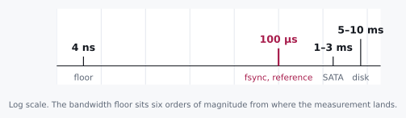

# The Barrier

> fsync is not a save button. It is a purchase.


Here is a loop you can write in about a minute. Take an 8-byte counter.
Append it to a file. Do that over and over. Then do it again with one
extra call, `fsync()`, after every append.

Before you run it, guess how much slower the second loop will be. Two
times? Ten? Write it down.

```python
import os, time

def appends_per_second(n, sync):
    fd = os.open("counter.bin", os.O_WRONLY | os.O_CREAT | os.O_TRUNC)
    start = time.perf_counter()
    for i in range(n):
        os.write(fd, i.to_bytes(8, "little"))   # an 8-byte counter
        if sync:
            os.fsync(fd)
    rate = n / (time.perf_counter() - start)
    os.close(fd)
    return rate

fast = appends_per_second(100_000, sync=False)
slow = appends_per_second(1_000, sync=True)
print(f"without fsync: {fast:>12,.0f} appends per second")
print(f"with fsync:    {slow:>12,.0f} appends per second")
print(f"one fsync:     {1e6 / slow:>12,.0f} µs")
print(f"slower by:     {fast / slow:>12,.0f}×")
```

Run it on a laptop with an SSD and the second loop typically comes out
hundreds of times slower. Run it on a spinning disk and it is worse.
One call, added to a loop that was already making a system call every
time round, and the loop falls off a cliff.

To persist eight bytes. Not eight megabytes. Eight bytes. Hold that number next to the size for
a moment, because something has gone badly wrong with our intuition
about what we just bought.

If `fsync` were charging us for the data, eight bytes would be the
cheapest thing we could possibly ask it to do. So either the data is
enormously more expensive to move than we think, or we are paying for
something else entirely and the data is beside the point.

Those two possibilities are the whole chapter, so let's take them
seriously one at a time.

## 2.1 Two Candidates and a Missing Number

The first candidate is the intuitive one. `fsync` is slow because it
moves our bytes to the device, and moving bytes takes time proportional
to how many bytes there are. Eight bytes is a small trip, but a trip to
a disk is a long way, and that is what we are paying for.

The second candidate says the byte count has nothing to do with it. We
are being charged for something that would cost the same if we had
handed over nothing at all.

Those two lead to opposite fixes, so it is worth an hour to tell them
apart. And we can do better than an hour, because there is a division
here that settles it in about ten seconds.

Name the ratio before you pick. At the reference machine's 2 GB/s of
device bandwidth, eight bytes should cost:

```
8 B ÷ 2 GB/s ≈ 4 nanoseconds
```

Now look at the last lines your program printed: one `fsync`, in
microseconds. On the reference machine it is 100 µs. On a laptop it is
often closer to a millisecond. Divide either one by 4 ns.

That is not a near miss. On the reference machine it is **25,000×**
over the bandwidth floor, and your machine is very likely worse.
The first candidate is not slightly wrong, or wrong in the details. It is
wrong by more than four orders of magnitude, which is the kind of wrong
you can see from orbit. Set it aside.

<p class="quip">Being wrong by four orders of magnitude is oddly restful. There is no danger whatsoever that you were nearly right.</p>

Which leaves candidate two, and a question we cannot answer by staring
at it any harder: if we are not paying for bytes, what exactly are we
paying for? For that we need some numbers.

<div class="aside">
This is chapter 1's floor test run in the opposite direction. There, a
measurement came in <em>under</em> every floor and proved work had been
skipped. Here it comes in wildly <em>over</em> the bandwidth floor and
proves the cost is not the thing we assumed we were buying. Same
instrument. You are just reading it from the other end.
</div>

## 2.2 The Axioms

We cannot derive what an `fsync` costs on a solid-state drive. It
depends on the drive's controller, and a controller is a fact about the
world rather than a consequence of anything. So the reference machine
hands us one number: an NVMe-class `fsync` round trip of 100 µs.

A spinning disk we can do better with, because there is a piece of
physics in it. A platter at 7200 revolutions per minute turns once every
60 ÷ 7200 seconds, which is 8.3 ms. If the head has to wait for the
right spot to come round, it waits half a turn on average: about 4 ms,
before a single byte is written. No firmware update will ever change
that, because it is a wheel.

But the spread between those two is not the interesting part, and if
you take only one thing from this section, take this instead.

Change the `8` in the program to `8192`, and run it again. The `fsync`
time barely moves. Run each size twice and you will likely find that two
runs of the same size disagree with each other more than the two sizes
do. The payload grew a thousandfold and the bill did not notice.

<p class="quip">A cost that ignores a thousandfold change in the payload is trying to tell you something, and it is not being subtle about it.</p>

That flatness is the whole tell. If a cost barely moves when you change
the payload by a factor of a thousand, then the payload was never the
dominant term. It was not even close to being the dominant term. You are
paying for something else, and the size of your data is a rounding error
on the bill.

So we are paying for an event rather than a quantity. The next question
writes itself: what event?

## 2.3 Doing the Division

The answer is that `fsync` is not really a write at all. It is a
**barrier**.

It blocks until every write queued before it is provably sitting on
non-volatile media. And it makes a second promise the name hides
completely: a promise about *order*. Nothing after the barrier gets to
be considered durable before everything ahead of it is.

Once you see it as a barrier rather than a save button, the flat cost
stops being mysterious. You are not paying to move bytes. You are paying
for a round trip: a request out to the device, a confirmation back, and
a wait in between that no amount of shrinking your payload will shorten.

This is the first tool of this part of the book, and it will outlive
every drive you ever own. Write any cost as two terms: a fixed price per
trip, and a price per byte carried.

```
time  =  fixed cost per event  +  bytes ÷ bandwidth
```

Then ask which term is the big one. For an 8-byte `fsync` the second
term is 4 ns and the first is 100 µs or more, so the second term is a
rounding error. The same two terms describe a network packet, a GPU
kernel launch, a database query and a trip to the shops, and the
question is always the same: are you paying for the trip or for the
cargo?



And that reframing immediately changes what we should do about it.
Paying the barrier once for a batch of a thousand records, and paying it
a thousand times for those same thousand records one at a time, are not
remotely the same purchase. The first is one round trip. The second is a
thousand of them, each one carrying almost nothing.

<div class="rule" id="boundary-not-spray">
<span class="rule-id">Rule 4 · A cost that ignores the payload is charged per event</span>
When a cost barely moves as the payload grows a thousandfold, you are
paying for the trip, not the cargo. Pay it once per batch, never once
per item. For `fsync`: once per boundary you need to defend, never once
per write.
</div>

## 2.4 What This Rules Out

Take that rule seriously for a moment and notice what it costs us,
because it is more than a tuning suggestion.

<p class="quip">Twenty-five thousand times slower, for eight bytes. You could hand-deliver the eight bytes.</p>

It rules out the intuition that durability is something you sprinkle on.
"Just fsync after every write, to be safe." Safety is not the axis that
scales badly here. Call *count* is. A service that fsyncs every record
has chosen to pay a toll of 100 µs to 10 ms on every operation, however
small, because the toll booth does not care what is in the trunk. It
charges for the stop.

Now let me push on something we have been quietly treating as one thing,
because I think it is really two, and separating them is what the next
chapter is built on.

Durability and ordering are different purchases. You can imagine a
system that needs its writes applied in order but does not need each one
durable the instant it lands. You can imagine the reverse too:
durability, with no opinion at all about relative order. Those are
genuinely different requirements, and a careful engineer might well want
to buy them separately.

`fsync` will not let you. It sells both, bundled, whether or not you
wanted the bundle.

<p class="quip">Two guarantees, one price, and no itemized receipt.</p>

And once you notice that, the design that follows is almost forced. Put
only the thing that must be *ordered and durable* behind the barrier,
and let everything else move lazily along behind it. That design has a
name, write-ahead logging, and chapter 10 comes back for it once we have
learned to distrust our own evidence. Before we leave it, it is worth
seeing the barrier drawn out, because the picture makes the waste obvious in a way
the arithmetic does not.

## 2.5 The Pictorial

Here it is drawn out. Three records queued above the line, one crossing,
and everything below it provably on the media:

```
 record 1 ─┐
 record 2 ─┤  queued, unordered w.r.t. the barrier
 record 3 ─┘
           │
     ══════╪══════  fsync()  ←  the barrier: one round trip,
           │                    ~100 µs – 10 ms, size-insensitive
           ▼
 [ record 1 | record 2 | record 3 ]  ← provably durable, in this order,
                                        only past this line
```

<p class="quip">Three records behind the barrier, or three thousand, at the same price. Enjoy it. Very little else in this book is on offer.</p>

That is the shape you want, and it costs one round trip no matter how
many records are stacked above the line.

<div class="aside">
Fsync-per-record redraws that picture a thousand times for a thousand
records. A thousand barriers, each paying a full round trip to escort a
single row across. Group commit, in chapter 3, is what happens once you
let the queue fill up before you draw the line.
</div>

<div class="aside">
<strong>Run it.</strong> <code>experiments/03_fsync_cost.c</code> syncs
payloads from 8 B to 8 MB and prints how far the cost moved against how far
the size moved. Predict that ratio first. See <a href="./experiments.md">Experiments</a>.
</div>

<div class="challenges">

## Challenges

1. You batch 100 records behind one `fsync` instead of syncing each
   individually. Using the NVMe number above, what's the best-case
   throughput improvement, and what would make the real improvement
   fall short of it?

2. A teammate suggests using `fdatasync` instead of `fsync` to skip
   metadata (mtime, size) updates. Under what circumstance does that
   optimization not actually save a barrier crossing?

3. Two threads each call `fsync` on the same file at nearly the same
   time. Does the second call's cost look like a second full barrier,
   or something cheaper, and what would you measure to find out, per
   Rule 3?

4. `O_DIRECT` writes bypass the page cache entirely. Does that make
   `fsync` unnecessary for durability? Name the specific claim `fsync`
   makes that a direct write, by itself, does not.

</div>

<div class="challenges" id="design-note">

## Design Note: The Bundle You Didn't Ask For

Every `fsync` call sells two things at once. *This data is durable*, and
*everything before it happened first*. Most of us only ever reach for it
because we want the first one, and we pay for the second without ever
noticing there was a second.

That would be fine if the second one were free. It is not. Ordering
guarantees are precisely what turn a bandwidth-bound operation into a
latency-bound one, because proving order means waiting for confirmation,
and waiting is the exact opposite of throughput. You cannot pipeline a
promise.

The systems that get this right unbundle it deliberately. They find the
one thing that genuinely needs the full barrier, and it is almost always
a small append-only log, and then they let everything downstream inherit
durability without ever calling `fsync` on its own behalf.

There is no trick in that. Nothing clever. They just declined to buy the
bundle twice, which turns out to be a good deal of what separates a
database from a program that writes files.

</div>
