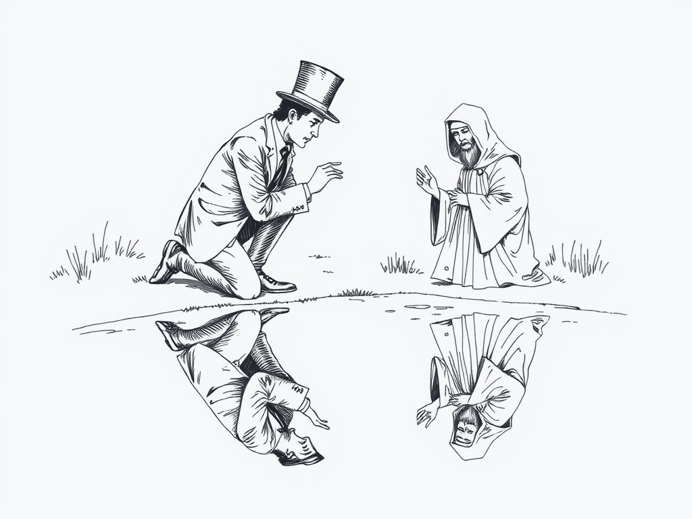
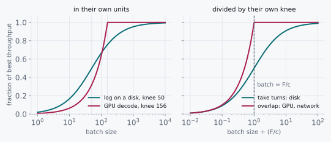

# The Same Equation

> Three fields, three names, one fraction.



Here are two machines that have nothing to do with each other. One is a
database writing its log to a disk, a problem people were solving
before most of us were born. The other is a GPU generating words from a
language model, a far younger problem. Different decades, different
hardware, different people, different conferences, different words for
everything.

Both of them can do their work one item at a time, or in batches. So
here is the question, and I want you to answer it before you read on:
**which of the two gains more from batching, and by roughly how much?**
Ten percent? Ten times? A thousand? Write down a number for each.

You do not have to take my word for either one. The disk half runs on
any machine with a real disk under it:

```python
import os, time, statistics

record = b"x" * 4096
fd = os.open("knee.log", os.O_WRONLY | os.O_CREAT | os.O_TRUNC)

def batch_time(b, runs=30):
    times = []
    for _ in range(runs):
        t = time.perf_counter()
        for _ in range(b):
            os.write(fd, record)
        os.fsync(fd)
        times.append(time.perf_counter() - t)
    return statistics.median(times)

one, big = batch_time(1), batch_time(256)
c = (big - one) / 255          # the price of one more record
F = one - c                    # the price of the trip itself
print(f"F = {F*1e6:.0f} µs   c = {c*1e6:.1f} µs   knee F/c = {F/c:.0f}")
for b in (1, 4, 16, 64, 256):
    print(f"batch {b:4}: {batch_time(b)/b*1e6:7.1f} µs per record")
os.close(fd)
```

Run it from a directory on your real disk. (Not `/tmp` on most Linux
machines: that is often memory pretending to be a disk, and `fsync` on
it costs nothing, which is chapter 1's floor test catching you before
you have even started.) The GPU half is the batch sweep in
`experiments-gpu/07_roofline.py` from chapter 4, and the column you
want is the fraction of peak at each batch size.

<p class="quip">Two machines, forty years apart, and both of them were waiting for the same reason.</p>

Now look at the two outputs side by side. The numbers disagree, which
you expected. What I did not expect, the first time I lined them up, is
that the *curves* do not disagree at all. Both start low. Both rise in
proportion to the batch for a while. Both bend at some batch size and go
flat, and past the bend more batching buys nothing. Two machines that
share no part, no vendor and no vocabulary draw the same line.

That is either a coincidence, or the two problems are secretly one
problem. I do not believe in coincidences that clean, and I suspect you
do not either.

## 13.1 Candidates and the Ratio

There are two ways to explain it.

The first: it is a coincidence of shape. Lots of things rise and then
level off. A storage engineer would explain the disk curve with
storage reasons, a GPU engineer would explain the GPU curve with GPU
reasons, and each explanation would be correct and would have nothing
to say about the other. Under this candidate, knowing one field tells
you nothing about the other, and the right move is to learn both, one
fact at a time.

The second: it is the same problem. Somewhere under the two vocabularies
there is one equation, and if we can find it, one number from it will
answer the opening question for both machines at once, and for machines
neither of us has met yet.

The spread between those two is not 2× or 10×. It is the difference
between learning one thing and learning every field separately, which
is the largest ratio in this book. Rule 1 says ask the question with the
widest spread first, so we ask it.

## 13.2 The Axioms

The numbers are all on the reference machine, and every one of them was
already in an earlier chapter. Nothing new is being handed over. That is
rather the point.

| Reference machine | Value | Where it came from |
|---|---|---|
| `fsync` round trip | 100 µs | chapter 2 |
| NVMe sequential write | 2 GB/s | chapter 1 |
| GPU compute | 312 TFLOP/s | chapter 4 |
| GPU memory bandwidth | 2 TB/s | chapter 4 |
| 7B model weights, fp16 | 14 GB | chapter 4 |

## 13.3 Doing the Division

The trick is to refuse, for one page, to use any word that belongs to
either field. No `fsync`, no weights, no tokens, no log. Describe each
problem in its own terms: what does it cost to do one batch of b items?

On the disk, every batch pays for one trip to durable storage, no matter
what it carries, and then each record pays for its own bytes:

```
trip      F  =  one fsync round trip     =  100 µs
per item  c  =  4 KB ÷ 2 GB/s            ≈    2 µs
```

On the GPU, every batch pays for one read of all the weights, no matter
how many sequences ride along, and then each sequence pays for its own
arithmetic:

```
trip      F  =  14 GB ÷ 2 TB/s           =    7 ms
per item  c  =  14 GFLOP ÷ 312 TFLOP/s   ≈   45 µs
```

Now the two problems are written in the same symbols, and the symbols do
not know which field they came from. A batch of b items costs a trip and
b small payments. Per item, that is

```
time per item  =  F/b + c
```

and you can read everything off it without another axiom. At b = 1 the
trip dominates. As b grows, the trip is shared and shrinks. It stops
mattering at the batch where the two terms are equal, where F/b = c,
which is

```
knee  =  F / c

disk:  100 µs ÷  2 µs  =   50
GPU:     7 ms ÷ 45 µs  ≈  156
```

<p class="quip">One hundred and fifty-six. If that number looks familiar, it should. It has been following us since chapter 4.</p>

So the answer to the opening question is: the GPU gains about 156 times
from batching and the disk about 50, and the most batching can ever buy
you is the knee itself, give or take one. Go back to your guesses.

And look at the GPU's knee. **156** is the ridge point. We did not
compute it from compute over bandwidth this time. We computed it from a
trip and a payment, and the same number came out, because they are the
same number: the ridge is where the weight read and the arithmetic cost
the same, and that is exactly the batch where F/b = c. Chapter 4 named
it a ridge. Chapter 3 never named it at all, and it was there too: the
group commit batch that stops paying is 50 records on this machine.

<div class="rule" id="same-equation">
<span class="rule-id">Rule 15 · Describe the problem in its own terms before its vocabulary</span>
Strip out the field's names and write what one unit of work costs, in
symbols. If the symbols match a problem you have solved, the old answer
transfers, along with its assumptions. For batching: write a fixed trip
F and a per-item price c, and the batch stops paying at F/c.
</div>

Now let's test the rule on a field this book has not touched, because a
tool that only explains what we already knew is a story, not a tool.

A network connection sends data and waits for the receiver to
acknowledge it. Every window of data pays for one round trip, and every
byte pays for its own time on the wire. Without one word of networking
vocabulary, the equation says there is a knee at F/c, and the window has
to hold at least that many bytes or the link sits idle. Put in two
numbers, a 10 Gb/s link (1.25 GB/s) and a round trip of 100 µs inside
one building:

```
trip      F  =  100 µs
per byte  c  =  1 byte ÷ 1.25 GB/s  =  0.8 ns
knee      =  F / c  =  125,000 bytes
```

Networking does have a name for that number. It is the **bandwidth-delay
product**, and RFC 7323, the standard for TCP's window extensions, opens
with it: "TCP performance problems arise when the bandwidth \* delay
product is large."[^rfc7323] The same section gives the reason the
extension had to exist at all. The original TCP header has a 16-bit
window field, so "the largest window that can be used is 2^16 = 64
KiB."

Do the division yourself before the next paragraph. A 64 KiB window,
against a knee of 125,000 bytes, inside the building.

About half the link. Now stretch the cable under an ocean. Light in
glass covers about 200,000 km a second, which is not a hardware number
and will not change, so 10,000 km of fiber is 50 ms each way and a
100 ms round trip. The knee becomes 1.25 GB/s × 0.1 s = **125 MB**. A
64 KiB window sends 65,536 bytes per 100 ms, which is 0.66 MB/s on a
link that can carry 1,250. Five hundredths of one percent.

<p class="quip">A ten-gigabit link across an ocean, carrying data at the speed of a dial-up modem, and every part of it working perfectly.</p>

I did not need to know any networking to find that. I needed a trip,
a payment, and one division I had already done twice.

## 13.4 What This Rules Out

This rules out the first candidate, and it rules out with it the habit
of learning every field as its own list of facts. Group commit, the
ridge point and the bandwidth-delay product are not three things to
memorize. They are one fraction, met three times, under three names.

But the rule carries a warning in its second sentence, and it is the
part people skip. **An old answer transfers with its old assumptions,**
and you have to check each one before you trust the transfer.

Our equation assumes the trip costs the same however much the batch
carries, and that nothing else limits b. On the GPU, the second
assumption is false. Chapter 5 found that the KV cache runs out of
memory at 66 sequences, long before the knee at 156. The equation said
156; a ceiling that is not in the equation said 66; the ceiling wins,
because [the lowest ceiling binds](./08-kv-cache.md#kv-budget-not-guess).
The shape told us where the batch *stops paying*. It never promised the
batch could get there.

<div class="aside">
The two curves are also not quite identical, and the difference is
worth knowing. On the disk the trip and the records take turns: write,
then sync. On the GPU the arithmetic overlaps the weight read, so a
batch costs the larger of the two rather than their sum. Taking turns
gives a round bend; overlapping gives a sharp corner. They differ most
at the knee itself, where one gets half the best throughput and the
other gets all of it: a factor of 2, and nowhere more than that. By
rule 1 that is a detail. The knee is where it is either way.
</div>

The second thing it rules out is subtler. It rules out the belief that
an idea is *new* because its vocabulary is. Chapter 7's paged attention
is virtual memory from 1962, put to work on a cache that nobody in
1962 could have pictured. Chapter 12's recorded launch sequence is the same move
as a database preparing a query plan once and running it many times.
Each time, somebody described a problem in its own terms, and found it
had been solved already, by people who would not have recognized the
words.

## 13.5 The Pictorial

The two machines on one chart, first in their own units and then with
each batch size divided by its own F/c:



<p class="quip">Divide by the right number and two fields become one picture. It is the cheapest unification in science.</p>

On the left the knees sit in different places, because the machines
are different. On the right they sit in the same place, because the
problem is not. Your own two outputs from the start of the chapter,
divided by your own two knees, will land on the right-hand panel.

<div class="aside">
<strong>A dated field note.</strong> In 2026, on a laptop NVMe drive
under ext4, three runs of the snippet above printed knees of 55, 107
and 117. The trip is an `fsync`, and `fsync` times are noisy from run to
run, so the knee moves by 2×. The bend did not move out of that range,
and the cost per record still fell from about 1.5 ms at batch 1 to
about 20 µs at batch 256.
</div>

<div class="challenges">

## Challenges

1. The snippet estimates F and c from only two batch sizes, 1 and 256.
   Fit them to all five instead, and say how much the knee moves. Then
   say which of the two estimates you would trust, and why.

2. Chapter 12's kernel launches cost a fixed price each, about 17 µs,
   and a CUDA graph replays all of them for one. Write that problem in
   the symbols of this chapter: what is the trip, what is the item, and
   where is the knee?

3. Find a fourth instance of F/b + c outside computing: anything that
   pays one fixed price per batch and a small price per item. Compute
   its knee from numbers you can estimate, and say whether the people
   in that field already batch near it.

4. The rule says an old answer transfers with its old assumptions. Name
   an assumption of the group commit answer that a network window does
   not share, and say what goes wrong if you transfer the answer
   anyway.

</div>

<div class="challenges" id="design-note">

## Design Note: Vocabulary Is a Wall

Every field builds its vocabulary for good reasons. Names are how
people inside a field talk fast, and talking fast is how a field gets
anything done. I have no quarrel with that.

But a vocabulary is also a wall. It keeps the field's knowledge in, and
it keeps everyone else's out. A storage engineer and a GPU engineer can
sit at the same table, solve the same equation, and never find out,
because one says "group commit" and the other says "ridge point," and
neither word means anything to the other person. Each of them will tell
you, correctly, that their problem has details the other one's does
not. The details are real. The equation underneath is also real, and it
is the part that lasts.

So the habit I want you to take from this chapter is a small one, and
it costs a page. Before you search for what your field calls the
problem, write the problem without its field: what is paid once, what
is paid per item, what is held, what runs out first. Then look at the
symbols and ask where you have seen them before. More often than you
expect, the answer is a paper from before you were born, and somebody
already found the knee.

</div>

[^rfc7323]: D. Borman, B. Braden, V. Jacobson and R. Scheffenegger (ed.),
    "TCP Extensions for High Performance", RFC 7323, September 2014,
    section 1.1. It obsoletes RFC 1323.
    <https://www.rfc-editor.org/rfc/rfc7323>
